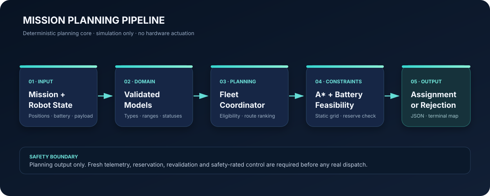
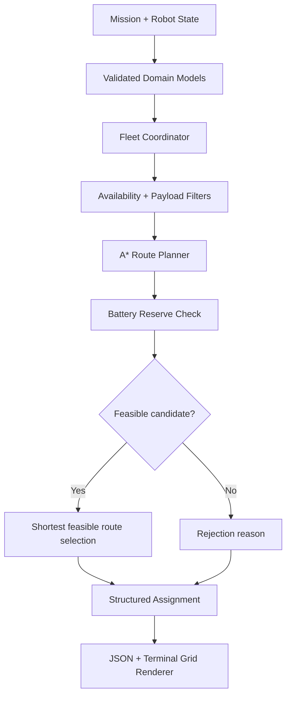

# AI Robot Fleet Coordinator
### Deterministic mission planning for a simulated warehouse fleet.

<p align="center">
  <strong>Model the fleet. Check mission feasibility. Find a route. Explain the assignment.</strong>
  <br/>
  A Python fleet-coordination prototype with validated robot state, A* grid path planning, payload and battery constraints, and a reproducible simulation scenario.
</p>

<p align="center">
  <a href="https://github.com/sunny-shrivas/ai-robot-fleet-coordinator/actions/workflows/fleet-ci.yml"></a>
  
  
  
  
  
</p>

---

## Project overview

Warehouse fleets need to allocate missions while respecting robot availability, carrying capacity, route length, and battery reserves. This project implements a small, inspectable planning core for that problem.

Given a mission and a snapshot of robot state, the coordinator:

1. Filters out robots that are unavailable or cannot carry the payload.
2. Plans a route from each eligible robot to the pickup point.
3. Plans a route from pickup to destination on a static occupancy grid.
4. Estimates energy use using a configurable percentage-per-step assumption.
5. Rejects assignments that would cross the mission's battery reserve.
6. Selects the shortest feasible total route; ties prefer higher projected battery and then a stable robot ID.
7. Returns a structured assignment or an explicit rejection reason.

**Design principle: a mission is only plan-ready when the deterministic constraints pass.**

> **Scope:** This is a simulation and planning prototype. It does not connect to physical AMRs, ROS 2, Nav2, sensors, motor controllers, or fleet telemetry. It does not send robot commands. The battery model is a simple configurable estimate, not a calibrated physical model.

## Architecture

<p align="center">
  
</p>

The planning core is deliberately independent of external LLM services. This keeps route generation and hard constraints repeatable and testable. A future AI layer can translate natural-language requests into validated mission objects or explain assignments, but it must not override deterministic feasibility checks.



## Core components

| Component | Responsibility |
|---|---|
| `fleet/models.py` | Validated `Robot`, `Mission`, `Position`, and `Assignment` domain models |
| `fleet/grid.py` | A* route search over a 4-connected static occupancy grid |
| `fleet/coordinator.py` | Robot eligibility, route comparison, payload and battery reserve checks |
| `fleet/visualization.py` | Text-based warehouse grid showing route, obstacles, pickup, destination and robot |
| `fleet/demo_data.py` | Repeatable sample warehouse and mission |
| `main.py` | Demo entry point that prints a structured result and route map |
| `tests/` | Unit tests for path planning, model validation, assignment logic and rendering |

## Example output

The bundled scenario uses three simulated robots, two obstacle clusters, a 12 kg delivery payload, and a 20% minimum battery reserve.

The planner evaluates each available robot and chooses the shortest feasible route. The demo prints a JSON assignment with:
- Selected robot ID.
- Route as grid coordinates.
- Estimated step count.
- Estimated remaining battery percentage.
- A reason that explicitly states no command was dispatched.

The terminal grid uses:

| Symbol | Meaning |
|---|---|
| `R` | Selected robot starting position |
| `P` | Pickup location |
| `D` | Delivery destination |
| `*` | Planned route |
| `#` | Static obstacle |
| `.` | Free cell |

## Algorithms and constraints

### A* path planning
- 4-connected movement: up, down, left and right.
- Manhattan-distance heuristic.
- Unit cost per grid step.
- Static obstacles are treated as blocked cells.
- Returns the shortest path under those grid assumptions, or raises a clear error when no path exists.

### Mission feasibility
A robot is considered only when:
- Its state is `available`.
- Its payload capacity meets or exceeds the mission payload.
- A route exists from its current position to pickup and from pickup to destination.
- Its projected battery remains at or above the configured reserve.

The current energy estimate is:

```text
projected_energy_pct = route_steps × estimated_energy_pct_per_step
projected_battery_pct = current_battery_pct - projected_energy_pct
```

### Robot selection
Among feasible candidates:
1. Minimize total route steps.
2. Prefer greater projected battery when route lengths are equal.
3. Use robot ID as a deterministic final tie-break.

Planning reads a robot-state snapshot and does not reserve or mutate robot state. A real dispatcher would need atomic reservation, fresh telemetry, concurrency control and revalidation before execution.

## Quickstart

### 1. Clone the repository

```bash
git clone https://github.com/sunny-shrivas/ai-robot-fleet-coordinator.git
cd ai-robot-fleet-coordinator
```

### 2. Create a virtual environment

**macOS / Linux**

```bash
python3 -m venv .venv
source .venv/bin/activate
```

**Windows PowerShell**

```powershell
python -m venv .venv
.venv\\Scripts\\Activate.ps1
```

### 3. Install dependencies

```bash
python -m pip install --upgrade pip
pip install -r requirements.txt
```

The deterministic planner uses the Python standard library. The requirements file installs Pytest for the automated test suite. No OpenAI key, CrewAI account or external service is required to run the current demo.

### 4. Run the fleet demo

```bash
python main.py
```

### 5. Run tests

```bash
python -m pytest -q
```

## Quality checks

GitHub Actions runs on pushes and pull requests. It:
- Installs the declared Python dependencies.
- Runs the automated test suite.
- Compiles the Python source tree to catch syntax errors.

The test suite covers A* routing around obstacles, blocked/unreachable destinations, route feasibility, battery reserves, payload capacity, robot status, input validation and route rendering.

## Repository structure

```text
.
├── .github/
│   └── workflows/
│       └── fleet-ci.yml
├── assets/
│   └── fleet-architecture.svg
├── fleet/
│   ├── __init__.py
│   ├── coordinator.py
│   ├── demo_data.py
│   ├── grid.py
│   ├── models.py
│   └── visualization.py
├── tests/
│   ├── test_coordinator.py
│   ├── test_grid.py
│   ├── test_models.py
│   └── test_visualization.py
├── .gitignore
├── LICENSE
├── main.py
├── README.md
└── requirements.txt
```

## Current limitations

This prototype is intentionally bounded:
- The grid is static and 2D; there is no dynamic obstacle avoidance.
- Motion is 4-connected with uniform step costs; robot footprint, turning radius, acceleration and kinematics are not modeled.
- Battery usage is a linear estimate provided by the mission; no battery telemetry or learned energy model exists.
- Robot state is an in-memory snapshot; there is no fleet database, reservation lock or concurrent dispatcher.
- Mission priority is stored as metadata but there is no multi-mission queue or scheduling policy yet.
- There is no ROS 2 / Nav2 bridge, hardware driver, safety-rated controller or physical robot connection.
- The current implementation is deterministic; CrewAI/LLM agents are not part of the runtime path.

**Do not use this project to control physical equipment.** A production system would require validated robot dynamics, localization, live perception, collision checking, traffic coordination, safety-rated controls, fault handling and hardware-in-the-loop testing.

## Roadmap

- [x] Typed robot, mission and assignment models
- [x] Static occupancy grid and A* route planner
- [x] Payload, status and battery-reserve feasibility checks
- [x] Deterministic robot selection and rejection explanations
- [x] Terminal route visualization
- [x] Automated tests and GitHub Actions CI
- [ ] Multi-mission queue with priority-aware scheduling
- [ ] Time-window and charging-station planning
- [ ] Dynamic obstacle updates and weighted travel costs
- [ ] Simulation adapter (for example, a warehouse simulator)
- [ ] ROS 2 / Nav2 integration behind a simulation-first boundary
- [ ] Optional LLM layer for request parsing and human-readable mission explanations
- [ ] Metrics dashboard and scenario evaluation

## Maintainer

**Sunny Shrivas**  
AI Engineer · Python · Agentic Systems · Robotics Software

- GitHub: [@sunny-shrivas](https://github.com/sunny-shrivas)
- LinkedIn: [Sunny Shrivas](https://www.linkedin.com/in/sunny-shrivas-ss5ss0805)

---

<p align="center">
  <strong>Plan deterministically. Validate every constraint. Keep humans in control.</strong>
</p>
