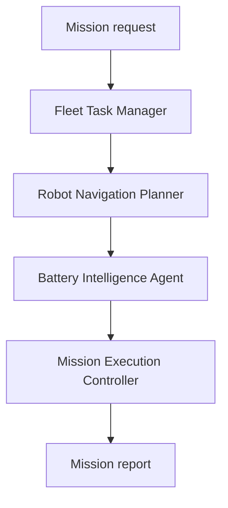

# AI Robot Fleet Coordinator

A CrewAI-based multi-agent prototype that models how a warehouse robot fleet could coordinate delivery missions. The project separates fleet task allocation, navigation planning, battery checks, and mission reporting into four specialist agents.

> **Mission request → Task allocation → Route proposal → Battery review → Mission report**

## Project goals

Warehouse and industrial AMR fleets need to coordinate work while considering robot availability, workload, route efficiency, and battery constraints. This project explores that coordination pattern through role-specialized LLM agents.

## Agent team

| Agent | Responsibility in this prototype |
|---|---|
| Fleet Task Manager | Reviews the mission request and proposes a robot assignment based on availability, workload, and priority. |
| Robot Navigation Planner | Produces a proposed route and considers route safety and obstacle avoidance in its reasoning. |
| Battery Intelligence Agent | Reviews battery-related mission feasibility and can recommend charging before a mission. |
| Mission Execution Controller | Produces the final mission execution/completion report. |

The agents and tasks are defined in `agents/` and `crew.py`. They are coordinated through a CrewAI `Crew` and launched by `main.py`.

## Architecture



## Technology

- Python
- CrewAI
- LangChain
- OpenAI integration
- python-dotenv

## Repository structure

```text
.
├── agents/
│   ├── task_manager.py
│   ├── path_planner.py
│   ├── battery_monitor.py
│   └── mission_executor.py
├── crew.py
├── main.py
├── requirements.txt
└── README.md
```

## Setup

Use a virtual environment:

```bash
git clone https://github.com/sunny-shrivas/ai-robot-fleet-coordinator.git
cd ai-robot-fleet-coordinator

python -m venv .venv
```

Activate it:

**macOS/Linux**
```bash
source .venv/bin/activate
```

**Windows PowerShell**
```powershell
.venv\Scripts\Activate.ps1
```

Install the dependencies:

```bash
python -m pip install --upgrade pip
pip install -r requirements.txt
```

Configure the OpenAI credentials required by your installed CrewAI/provider versions. Do not commit API keys. Use environment variables or a local `.env` file that is excluded from version control.

Example environment variable (set it in your shell or local environment file):

```dotenv
OPENAI_API_KEY=your_api_key_here
```

## Run

From the repository root:

```bash
python main.py
```

The entry point calls `fleet_crew.kickoff()` and prints the returned mission result. The current task descriptions are predefined in `crew.py`; this is a small proof of concept rather than a configurable fleet simulator.

## Current scope and limitations

This repository demonstrates agent-role decomposition and sequential task orchestration. It does **not** currently provide:

- A connection to physical AMRs, motors, sensors, or robot telemetry.
- ROS 2 or Nav2 integration.
- A map-based path-planning algorithm or verified collision avoidance.
- A numerical battery model, live state-of-charge readings, or battery prediction.
- A fleet database, dispatch API, or web monitoring dashboard.
- A deterministic simulation environment or automated test suite.

Route, battery, and execution outputs are LLM-generated recommendations/reports, not validated commands for real robots. Do not use the output to control physical equipment.

## Roadmap

- Add structured mission, robot, and telemetry inputs.
- Implement deterministic robot assignment and battery-feasibility checks.
- Integrate a simulated warehouse map and path-planning algorithm.
- Add ROS 2/Nav2 integration behind a safe simulation boundary.
- Add unit tests, scenario tests, and evaluation metrics.
- Build a dashboard for mission status and fleet observability.

## Author

**Sunny Shrivas**  
AI Engineer | Generative AI | Agentic Systems
